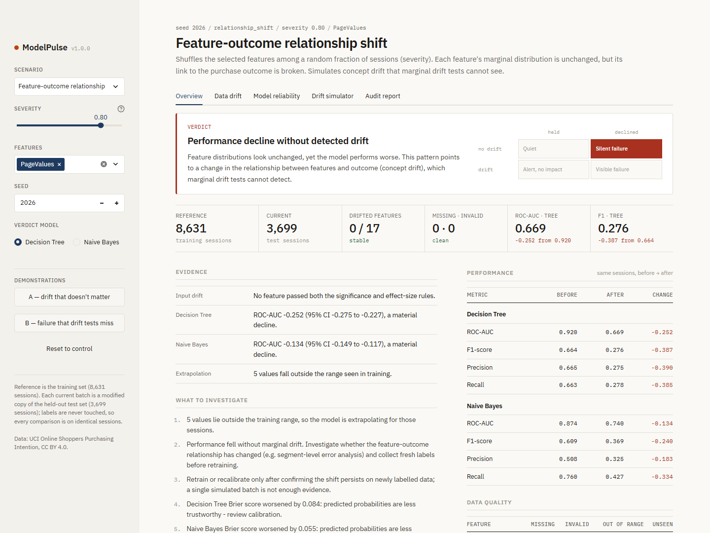
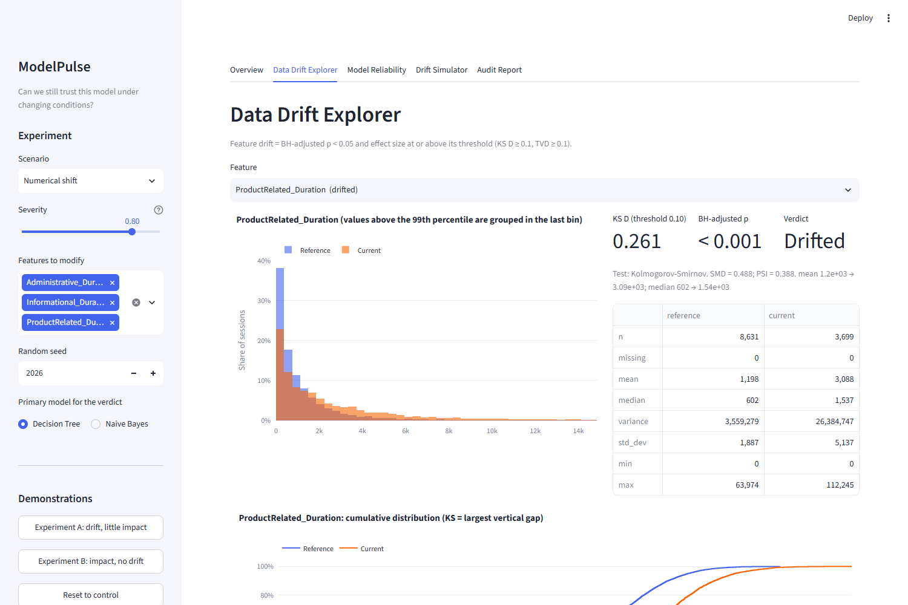
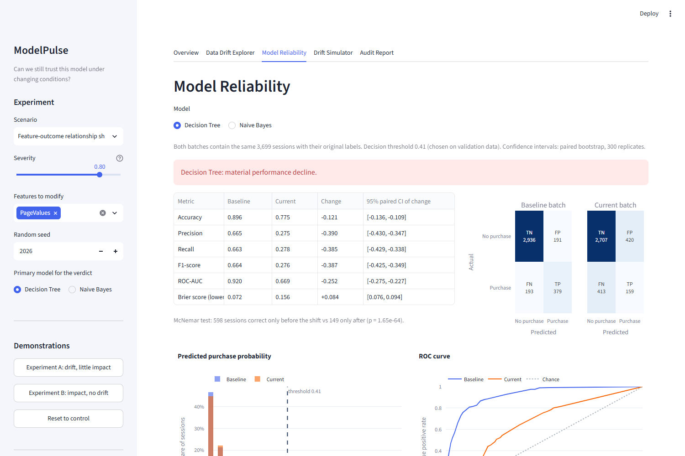
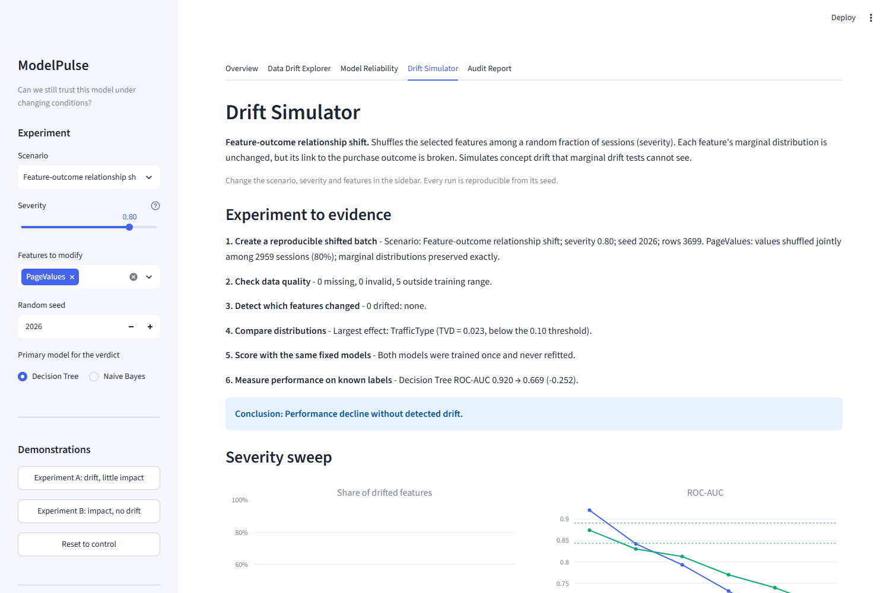
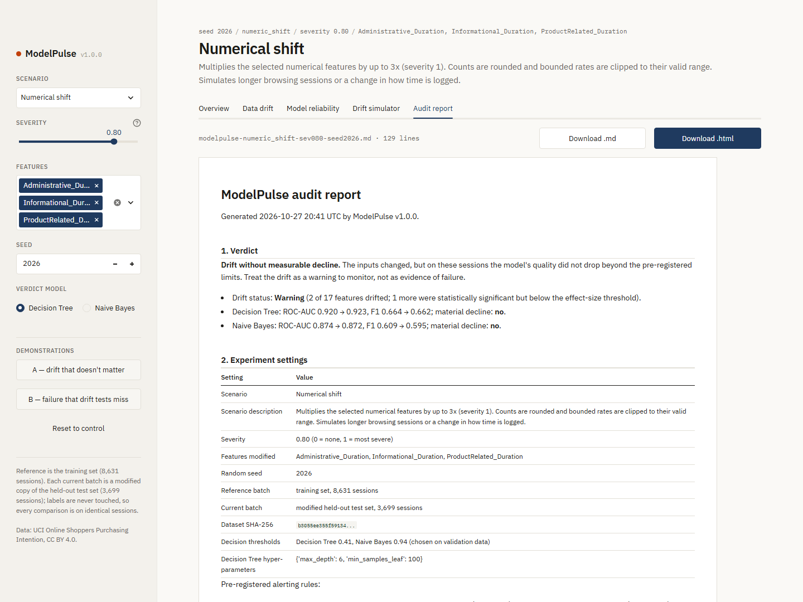
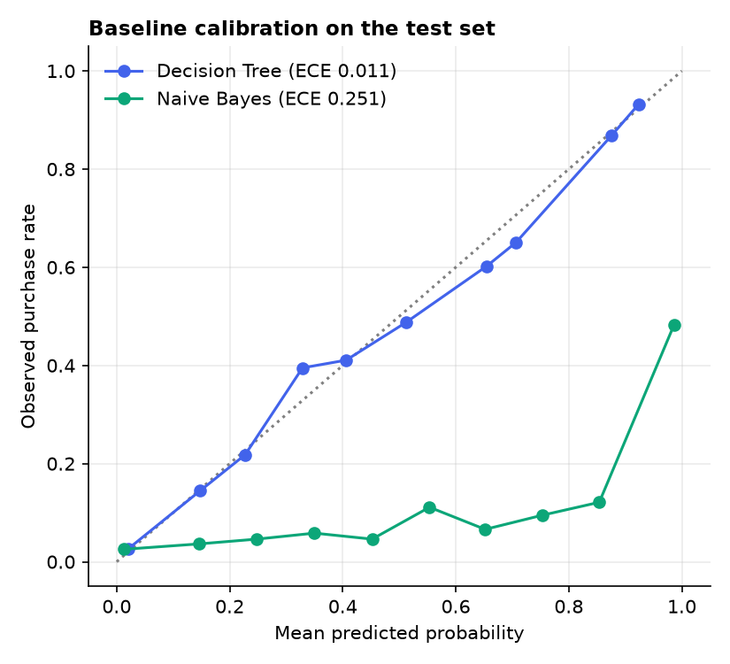
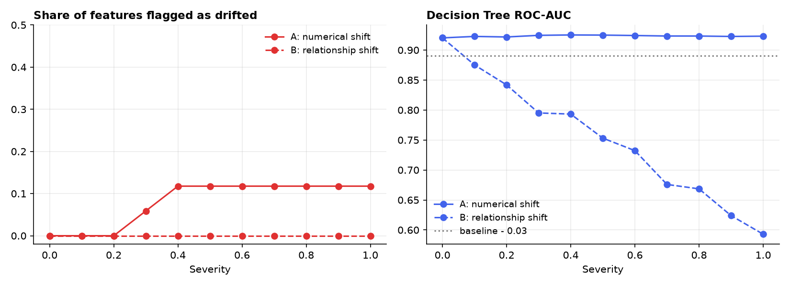
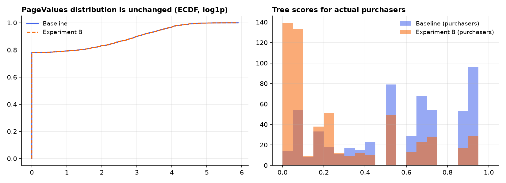

# ModelPulse

**An interactive AI reliability lab: can we still trust this model when the data changes?**

ModelPulse is a Python + Streamlit application that shows when a machine-learning model is
receiving unfamiliar data, how its predictions change, and whether its real performance has
deteriorated. It runs controlled, reproducible drift experiments on a purchase-prediction model
and explains, with statistical evidence, whether each experiment caused detectable drift, a
measurable performance decline, both, or neither.

The central design principle: **a distribution shift is a warning, not proof of model failure.**



---

## Contents

- [The problem](#the-problem)
- [What the app does](#what-the-app-does)
- [Quick start](#quick-start)
- [Methodology](#methodology)
- [Results](#results)
- [Limitations](#limitations)
- [Project structure](#project-structure)
- [Syllabus mapping](#syllabus-mapping)
- [Data and license](#data-and-license)

## The problem

An e-commerce company trains a model to predict whether a visitor will make a purchase. It works
well at launch. Later the visitor mix changes, browsing behaviour shifts, or a broken pipeline
starts sending missing values. The model keeps producing predictions - but are they still
reliable?

ModelPulse lets you:

1. compare the original (reference) data with a new batch,
2. detect changes in feature distributions,
3. see whether predictions changed,
4. evaluate performance when labels are available,
5. find which features and error types deserve attention, and
6. export an audit report that states its own limitations.

## What the app does

| Tab | Contents |
|---|---|
| **Overview** | Reference vs current batch size, drift status, missing/invalid counts, baseline vs current performance, plain-English verdict, recommended investigations |
| **Data Drift Explorer** | Per-feature distribution and ECDF plots, mean / median / variance / standard deviation, test statistic, BH-adjusted p-value, effect size, ranking of all 17 features, PCA view |
| **Model Reliability** | Confusion matrices, precision / recall / F1 / ROC-AUC with paired bootstrap CIs, McNemar test, predicted-probability distribution, ROC curve, calibration plot and ECE, Decision Tree vs Naive Bayes comparison |
| **Drift Simulator** | Scenario, severity and feature controls; the six-step experiment-to-evidence workflow; severity sweep; Experiment A vs B contrast |
| **Audit Report** | Downloadable Markdown / HTML report: settings, detected changes, metrics, warnings, recommended investigations, limitations |

| Data Drift Explorer | Model Reliability |
|---|---|
|  |  |
| **Drift Simulator** | **Audit Report** |
|  |  |

### Drift scenarios

| Scenario | What it does (severity 0 -> 1) |
|---|---|
| Unchanged control | Untouched test set - any alert is a false alarm |
| Numerical shift | Multiplies selected numerical features by 1x -> 3x (counts rounded, rates clipped) |
| Categorical shift | Moves 0% -> 60% of rows of a categorical feature to its second most common level |
| Missing-value injection | Blanks 0% -> 50% of selected values at random (MCAR) |
| Feature-outcome relationship shift | Shuffles selected features among 0% -> 100% of sessions: marginal distribution identical, link to the outcome broken |

Rows are never added, removed or reordered and labels are never modified, so every shifted batch
is evaluated on exactly the same sessions as the baseline.

## Quick start

Requires Python 3.11+ (developed and tested on 3.12).

```bash
git clone https://github.com/OshiSharma1222/ModelPlus.git
cd ModelPlus
python -m venv .venv
# Windows: .venv\Scripts\activate    macOS/Linux: source .venv/bin/activate
pip install -r requirements.txt

python scripts/download_data.py      # optional - the app downloads the data itself
streamlit run app.py                  # opens http://localhost:8501
```

The first launch downloads the dataset from UCI and trains both models (about 10 seconds).
Fitted artifacts are cached in `models/` (git-ignored).

```bash
python scripts/run_experiments.py   # regenerate reports/ and figures/
python -m pytest                    # 52 tests: metrics, drift, scenarios, preprocessing, app
```

> **Windows note:** if `import sklearn.tree` fails with *"An Application Control policy has
> blocked this file"*, Smart App Control is blocking a scikit-learn DLL. The pinned
> `scikit-learn==1.6.1` in `requirements.txt` imports without this problem.

## Methodology

### Data and splits

- **Online Shoppers Purchasing Intention Dataset** (UCI #468): 12,330 sessions, 17 features
  (10 numerical, 7 categorical), 15.5% purchases.
- Stratified 70/30 train/test split (seed 2026); 20% of training held back as validation, used
  **only** to choose each model's decision threshold (maximum F1).
- Reference batch = training set (8,631 sessions). Current batch = a modified copy of the
  untouched test set (3,699 sessions).

### Preprocessing (fitted on training data only)

Median / mode imputation, rare categories (<20 sessions) bucketed as `Other`, unseen categories
mapped to `Other`, `log1p` on skewed counts and durations. The same fitted transformer is applied
to test and monitoring data.

### Models

| Component | Method | Purpose |
|---|---|---|
| Baseline classifier | Decision Tree (depth and leaf size tuned by 5-fold CV on ROC-AUC) | Easy-to-explain behaviour |
| Comparison classifier | Naive Bayes (Gaussian numerical + Laplace-smoothed categorical likelihoods, implemented in `models.py`) | A different modelling assumption |
| Dimensionality reduction | PCA on standardised numerical features | Exploratory reference vs current view |

### Drift detection

| Feature type | Test | Effect size |
|---|---|---|
| Numerical | Two-sample Kolmogorov-Smirnov | KS D (plus standardised mean difference and PSI) |
| Categorical | Chi-square test of homogeneity; Monte-Carlo permutation p-value when > 20% of expected counts are < 5 | Total variation distance (plus Cramer's V and PSI) |

All 17 p-values are adjusted with **Benjamini-Hochberg**. A feature is flagged only when it is
significant **and** its effect size reaches a minimum, because with thousands of rows trivial
differences become significant.

### Pre-registered thresholds

These were fixed in `modelpulse/config.py` *before* the final scenarios were evaluated.

| Rule | Value |
|---|---|
| Significance level (BH-adjusted) | 0.05 |
| Minimum KS D / TVD | 0.10 / 0.10 |
| Batch status "Drift detected" | >= 20% of features drifted ("Warning" for >= 1) |
| Material decline | ROC-AUC drop >= 0.03 **or** F1 drop >= 0.05, with the paired bootstrap 95% CI (300 replicates) excluding zero |

### Data quality

Schema checks, missing values, domain-rule violations (negative durations, rates outside
[0, 1], unknown months / visitor types), values outside the training range, and category levels
never seen in training.

## Results

All numbers below are produced by `python scripts/run_experiments.py` (seed 2026) and are
stored in [`reports/results.csv`](reports/results.csv).

### Baseline (untouched test set)

| Model | Threshold | ROC-AUC | F1 | Precision | Recall | Brier | ECE |
|---|---|---|---|---|---|---|---|
| Decision Tree | 0.41 | 0.920 | 0.664 | 0.665 | 0.663 | 0.072 | 0.011 |
| Naive Bayes | 0.94 | 0.874 | 0.609 | 0.508 | 0.760 | 0.217 | 0.251 |

`PageValues` accounts for 83% of the tree's Gini importance. Naive Bayes ranks reasonably
(AUC 0.874) but is badly calibrated (ECE 0.251), which is why its F1-optimal threshold is 0.94 -
a good example of why calibration must be evaluated separately from discrimination.



### Experiments

| Experiment | Drift status | Drifted features | Tree ROC-AUC (95% CI of change) | Tree F1 change | Verdict |
|---|---|---|---|---|---|
| Control | Stable | none | 0.920 -> 0.920 | 0.000 | Neither drift nor decline |
| **A** - numerical shift, severity 0.8 (3 duration features) | Warning | ProductRelated_Duration, Administrative_Duration | 0.920 -> 0.923 (+0.003) | -0.002 | Drift without measurable decline |
| **B** - relationship shift, severity 0.8 (PageValues) | Stable | none | 0.920 -> 0.669 (-0.252, CI -0.275 to -0.227) | -0.387 | Performance decline without detected drift |
| Categorical shift, severity 0.8 (VisitorType) | Warning | VisitorType (TVD 0.42) | 0.920 -> 0.920 | 0.000 | Drift without measurable decline |
| Missing values, severity 0.6 (PageValues, ExitRates) | Stable | none | 0.920 -> 0.807 (-0.113) | -0.153 | Data-quality issue with performance decline |

### The key lesson: Experiment A vs Experiment B



- **Experiment A** triples browsing durations. The KS test flags two features with large effects
  (D = 0.26 and 0.17, adjusted p < 1e-60), yet the Decision Tree's AUC does not drop at any
  severity, because those features carry about 2% of its importance.
- **Experiment B** shuffles `PageValues` among 80% of sessions. Its distribution is *exactly*
  the same, so no drift test can fire, while the tree's AUC falls from 0.920 to 0.669 and recall
  from 0.66 to 0.28.



Drift alerts and performance are different questions. Marginal drift tests miss changes in the
feature-outcome relationship (concept drift), and a loud drift alert may be harmless. Monitoring
signals have to be read in context, and labels are irreplaceable when they are available.

The missing-value experiment shows a third pattern: the observed values look unchanged (MCAR
deletion does not move the distribution), but 50% of rows were scored on imputed inputs. The
data-quality checks, not the drift tests, catch it.

A full example audit report is in [`reports/example-report.md`](reports/example-report.md).

## Limitations

ModelPulse is careful about what it claims:

- Data drift does not automatically mean the model is failing.
- No detected drift does not prove that the model remains reliable (see Experiment B).
- A decline in metrics on a simulated batch is evidence about that experiment, not proof of
  production performance.
- Synthetic experiments are not equivalent to monitoring a real deployed service. The dataset has
  no time ordering, so all drift here is simulated.
- Statistical significance is not the same as business significance.
- PCA plots are exploratory visualisations, not a definitive reliability test.
- Only marginal (per-feature) drift is tested; multivariate drift detection is out of scope.
- Thresholds were chosen once, a priori, and are not optimised for any particular cost of error.

## Project structure

```
ModelPlus/
├── app.py                      # Streamlit app: five tabs
├── modelpulse/
│   ├── config.py               # features, paths, pre-registered thresholds
│   ├── data.py                 # download, stratified split, training-fitted preprocessor
│   ├── models.py               # Decision Tree and mixed Naive Bayes
│   ├── evaluation.py           # metrics, ROC-AUC, calibration, paired bootstrap, McNemar
│   ├── drift.py                # KS / chi-square tests, effect sizes, BH correction
│   ├── quality.py              # schema, missing, invalid, out-of-range checks
│   ├── scenarios.py            # reproducible drift scenarios
│   ├── experiment.py           # experiment-to-evidence workflow, severity sweeps
│   ├── report.py               # Markdown / HTML audit reports
│   └── plots.py                # Plotly figures
├── scripts/
│   ├── download_data.py
│   └── run_experiments.py      # regenerates reports/ and figures/
├── tests/                      # pytest suite (52 tests)
├── reports/                    # generated audit reports + results.csv
├── figures/                    # README figures and app screenshots
├── data/README.md              # dataset source, license, usage
├── requirements.txt
└── LICENSE
```

## Syllabus mapping

| Unit | Where it appears |
|---|---|
| I - Machine learning | Decision Tree, Naive Bayes, classification, PCA (`models.py`, `experiment.py`) |
| II - Supervised algorithms | Classifier comparison, threshold selection, confusion-matrix error analysis, McNemar test (`evaluation.py`, Model Reliability tab) |
| III - Statistics and data science | Descriptive statistics, stratified sampling, KS and chi-square tests, BH correction, bootstrap confidence intervals, effect sizes (`drift.py`, `evaluation.py`) |
| IV - Mathematics and analytics | Imputation, log transforms, standardisation, PCA, multivariate visualisation (`data.py`, `plots.py`) |

## Data and license

Data: *Online Shoppers Purchasing Intention Dataset*, C. Okan Sakar and Yomi Kastro, UCI Machine
Learning Repository, [CC BY 4.0](https://creativecommons.org/licenses/by/4.0/). The raw CSV is
not committed; see [`data/README.md`](data/README.md).

Code: [MIT](LICENSE).
